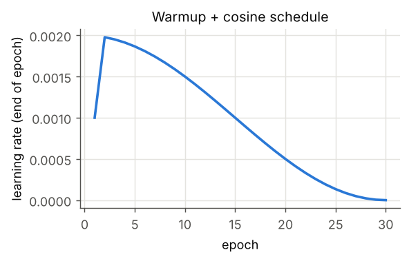
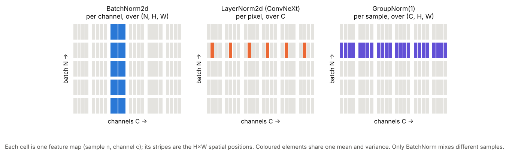

<div dir="rtl">

# پیاده‌سازی و آموزش معماری مبتنی بر بلوک‌های UIB در MobileNetV4 (به سبک ConvNeXt) روی CIFAR-10 و بررسی BatchNorm در برابر LayerNorm

## فهرست

1. [خلاصه‌ی نتایج](#summary)
2. [ساختار مخزن و نحوه‌ی اجرا](#repo)
3. [بلوک UIB در MobileNetV4](#uib)
4. [معماری پیاده‌سازی‌شده: ConvNeXt-UIB](#arch)
5. [داده و پیش‌پردازش](#data)
6. [حلقه‌ی آموزش](#train)
7. [آزمایش ۱: آموزش اصلی و روند Loss و Accuracy](#exp1)
8. [تحقیق: تفاوت BatchNorm و LayerNorm](#theory)
9. [آزمایش ۲: حساسیت به اندازه‌ی batch](#exp2)
10. [آزمایش ۳: تحلیل بدون آموزش (وابستگی به batch، حالت train/eval، ادغام BN در کانولوشن)](#exp3)
11. [جمع‌بندی](#conclusion)
12. [منابع](#refs)

<a id="summary"></a>
## ۱. خلاصه‌ی نتایج

%%SUMMARY%%

<a id="repo"></a>
## ۲. ساختار مخزن و نحوه‌ی اجرا

</div>

```
src/models.py              ConvNeXt-UIB model (UIB block from timm) + selectable normalisation layer
src/data.py                CIFAR-10 held in memory + batched augmentation (random crop + flip)
src/plotstyle.py           shared plot style
train.py                   training loop: timm AdamW + cosine/warmup + label smoothing, JSON log per epoch
run_experiments.sh         every training run in this report
bn_vs_ln_analysis.py       BN vs LN analysis (no training; uses the trained checkpoints)
plot_results.py            figures + results/summary.md
MobileNetV4_UIB_CIFAR10.ipynb  notebook (Colab-ready) that shows the model, training and results
results/                   per-epoch JSON histories, logs, figures
checkpoints/               trained weights of the two main models (BN and LN)
```

```bash
pip install -r requirements.txt
```

```bash
python train.py --data ./data --norm bn --epochs 30 --out results/main_bn.json
```

```bash
CIFAR_ROOT=./data ./run_experiments.sh && python bn_vs_ln_analysis.py --data ./data && python plot_results.py
```

<div dir="rtl">

تمام اجراها روی یک CPU چهار هسته‌ای (بدون GPU) انجام شد؛ به همین دلیل مدل کوچک (۱٫۹ میلیون پارامتر) و ۳۰ epoch انتخاب شد. روی GPU (مثلاً Colab) همان دستورات بدون تغییر اجرا می‌شوند.

<a id="uib"></a>
## ۳. بلوک UIB در MobileNetV4

بلوک **Universal Inverted Bottleneck (UIB)** در مقاله‌ی MobileNetV4 معرفی شد و تعمیم بلوک Inverted Bottleneck در MobileNetV2 است. ساختار پایه‌ی آن این است:

</div>

```
x ──► [DW k×k (اختیاری، start)] ──► PW expand (×e) + act ──► [DW k×k (اختیاری، mid)] + act ──► PW project ──► LayerScale ──► DropPath ──►(+)──► y
 └──────────────────────────────────────────────── skip (if in == out and stride == 1) ─────────────────────────────────────────────────┘
```

<div dir="rtl">

با روشن یا خاموش کردن دو کانولوشن depth-wise اختیاری، چهار بلوک شناخته‌شده از یک کد واحد به دست می‌آیند:

| نوع | DW شروع | DW میانی | معادل |
|---|---|---|---|
| **ConvNeXt-like** | ✓ | ✗ | بلوک ConvNeXt: DW بزرگ روی کانال‌های کم، سپس MLP |
| **ExtraDW** | ✓ | ✓ | نوآوری MobileNetV4: میدان دید بزرگ‌تر با هزینه‌ی کم |
| **IB** | ✗ | ✓ | بلوک Inverted Bottleneck در MobileNetV2 |
| **FFN** | ✗ | ✗ | بلوک FFN در ترنسفورمرها (دو کانولوشن ۱×۱) |

در این تمرین از پیاده‌سازی رسمی timm استفاده شده است: `timm.models._efficientnet_blocks.UniversalInvertedResidual`، یعنی همان کلاسی که مدل‌های `mobilenetv4_*` کتابخانه‌ی timm با آن ساخته می‌شوند. در timm هر کانولوشن داخل UIB یک `ConvNormAct` است، پس بر خلاف ConvNeXt اصلی (که تنها یک LN پس از DW دارد) **بعد از هر کانولوشن یک لایه‌ی نرمال‌سازی** قرار می‌گیرد. در نتیجه نوع نرمال‌سازی در کل شبکه اثر زیادی دارد و برای مقایسه‌ی BN و LN مناسب است.

<a id="arch"></a>
## ۴. معماری پیاده‌سازی‌شده: ConvNeXt-UIB

ساختار کلی (macro architecture) دقیقاً مانند ConvNeXt است و هر بلوک ConvNeXt با یک UIB در حالت ConvNeXt-like (`dw_start=7, dw_mid=0, exp_ratio=4`) جایگزین شده است:

| بخش | جزئیات | خروجی (برای ورودی ۳۲×۳۲) |
|---|---|---|
| Stem | patchify: کانولوشن ۲×۲ با stride ۲، سپس Norm (در ConvNeXt روی ImageNet این لایه ۴×۴/۴ است؛ برای تصاویر ۳۲×۳۲ از ۲×۲/۲ استفاده شد) | ۳۲×۱۶×۱۶ |
| Stage 1 | ۲ × UIB(ConvNeXt-like، DW 7×7، expansion 4) | ۳۲×۱۶×۱۶ |
| Downsample | Norm ← Conv 2×2/2 | |
| Stage 2 | ۲ × UIB | ۶۴×۸×۸ |
| Downsample | Norm ← Conv 2×2/2 | |
| Stage 3 | ۴ × UIB | ۱۲۸×۴×۴ |
| Downsample | Norm ← Conv 2×2/2 | |
| Stage 4 | ۲ × UIB | ۲۵۶×۲×۲ |
| Head | Global Average Pooling ← Norm ← Linear(10) | ۱۰ |

- تابع فعال‌سازی GELU (مانند ConvNeXt)، LayerScale با مقدار اولیه‌ی ۱e-6 و Stochastic Depth (DropPath) با نرخ خطی تا ۰٫۱.
- تعداد پارامترها: **۱٫۹۱ میلیون**.
- نوع نرمال‌سازی با یک آرگومان انتخاب می‌شود و در stem، تمام UIBها، لایه‌های downsample و head یکسان است:
  - `bn`: `BatchNorm2d` (و `BatchNorm1d` در head)
  - `ln`: `timm.layers.LayerNorm2d`، یعنی LayerNorm روی بعد کانال در هر پیکسل (channels-first، همان LN استفاده‌شده در ConvNeXt)
  - `gn1`: `GroupNorm` با یک گروه (LN روی C,H,W)؛ و `none`: بدون نرمال‌سازی

<a id="data"></a>
## ۵. داده و پیش‌پردازش

- CIFAR-10: ۵۰٬۰۰۰ تصویر آموزش و ۱۰٬۰۰۰ تصویر آزمون، ۳۲×۳۲، ۱۰ کلاس. فایل اصلی `cifar-10-python.tar.gz` استفاده شد (md5 = `c58f30108f718f92721af3b95e74349a`، برابر با فایل رسمی).
- کل داده به صورت tensor در حافظه نگه داشته می‌شود و augmentation (برش تصادفی با padding چهارپیکسلی از نوع reflect و قرینه‌ی افقی با احتمال ۰٫۵) به صورت برداری روی کل batch انجام می‌شود. با این کار به workerهای DataLoader نیازی نیست و همه‌ی هسته‌های CPU صرف مدل می‌شوند (زمان آماده‌سازی داده در هر epoch حدود ۰٫۶ ثانیه است).
- نرمال‌سازی ورودی با میانگین و انحراف معیار کانال‌های CIFAR-10.

<a id="train"></a>
## ۶. حلقه‌ی آموزش

| تنظیم | مقدار |
|---|---|
| بهینه‌ساز | AdamW از طریق `timm.optim.create_optimizer_v2` (bias و پارامترهای نرمال‌سازی بدون weight decay) |
| نرخ یادگیری | 2e-3، با warmup خطی ۲ epoch و سپس cosine تا 1e-6 (`timm.scheduler.CosineLRScheduler`، به‌روزرسانی در هر step) |
| weight decay | 0.05 |
| batch size | 128 |
| تعداد epoch | 30 |
| تابع هزینه | `timm.loss.LabelSmoothingCrossEntropy(0.1)` برای آموزش، cross-entropy ساده برای ارزیابی |
| معیارها | `timm.utils.accuracy` و `AverageMeter`، ذخیره‌ی Loss و Accuracy آموزش و آزمون در هر epoch |
| حافظه | channels_last (در CPU سرعت BN را حدود ۲ برابر کرد: ۵۱۰ ← ۲۵۱ میلی‌ثانیه در هر step) |



<a id="exp1"></a>
## ۷. آزمایش ۱: آموزش اصلی و روند Loss و Accuracy

%%EXP1%%

<a id="theory"></a>
## ۸. تحقیق: تفاوت BatchNorm و LayerNorm

### ۸-۱. تعریف

هر دو لایه یک عمل یکسان انجام می‌دهند و تفاوت فقط در **مجموعه‌ای است که میانگین و واریانس روی آن حساب می‌شود**:

</div>

$$\hat{x} = \frac{x - \mu_{\mathcal{S}}}{\sqrt{\sigma^2_{\mathcal{S}} + \epsilon}}, \qquad y = \gamma\,\hat{x} + \beta$$

<div dir="rtl">

برای یک tensor با ابعاد (N, C, H, W):

| لایه | مجموعه‌ی آماری $\mathcal{S}$ | تعداد (μ, σ²) برای N=8, C=16, H=W=6 | γ و β |
|---|---|---|---|
| **BatchNorm2d** | برای هر کانال c، روی (N, H, W): **همه‌ی نمونه‌های batch** | 16 | برای هر کانال |
| **LayerNorm2d** (ConvNeXt) | برای هر نمونه و هر پیکسل (n, h, w)، روی C | 288 | برای هر کانال |
| **LayerNorm** (ترنسفورمر/ MLP) | برای هر نمونه (یا هر توکن)، روی بعد ویژگی | — | برای هر ویژگی |
| **GroupNorm(1)** | برای هر نمونه، روی (C, H, W) | 8 | برای هر کانال |



درستی این تعاریف در `bn_vs_ln_analysis.py` با مقایسه‌ی خروجی لایه‌های PyTorch/timm و فرمول دستی بررسی شده است (بیشترین اختلاف حدود 1e-7، یعنی خطای گردکردن float32).

### ۸-۲. تفاوت‌های اصلی

| ویژگی | BatchNorm | LayerNorm |
|---|---|---|
| وابستگی به نمونه‌های دیگر batch | **دارد**: خروجی یک تصویر به بقیه‌ی تصاویر batch بستگی دارد | **ندارد**: هر نمونه مستقل نرمال می‌شود |
| رفتار در آموزش و آزمون | **متفاوت**: آموزش با آمار batch، آزمون با میانگین متحرک (running mean/var) | **یکسان** |
| batch کوچک | تخمین آماری پرنویز، کاهش دقت؛ batch=1 (با یک مقدار در هر کانال) اصلاً ممکن نیست | بدون مشکل |
| آموزش توزیع‌شده | برای batch کوچک روی هر GPU به SyncBN نیاز دارد | نیازی ندارد |
| داده‌های دنباله‌ای با طول متغیر (RNN و ترنسفورمر) | نامناسب | استاندارد |
| هزینه‌ی inference | **صفر**: آمار ثابت است و در وزن و bias کانولوشن قبلی ادغام (fold) می‌شود | آمار به ورودی بستگی دارد و قابل ادغام نیست؛ محاسبه‌ی اضافه در هر لایه |
| اثر تنظیم‌کنندگی (regularization) | دارد: نویز ناشی از آمار batch | ندارد |
| کاربرد رایج | CNNها: ResNet، EfficientNet، **MobileNetV4** | ترنسفورمرها، ViT، **ConvNeXt** |

### ۸-۳. چرا هر کدام کار می‌کنند؟

- **BatchNorm** (Ioffe & Szegedy, 2015): هدف اولیه کاهش «internal covariate shift» بیان شد. پژوهش‌های بعدی (Santurkar et al., 2018) نشان دادند دلیل اصلی بیشتر **هموارتر شدن سطح loss** و پایدارتر شدن گرادیان است که امکان استفاده از نرخ یادگیری بزرگ‌تر را می‌دهد. نویز آمار batch نیز نوعی regularization است.
- **LayerNorm** (Ba et al., 2016): برای RNNها معرفی شد، چون در آن‌ها آمار batch در طول زمان معنای ثابتی ندارد. در ترنسفورمرها استاندارد شد. ConvNeXt (Liu et al., 2022) نشان داد که در یک CNN مدرن، جایگزینی BN با LN مشکلی ایجاد نمی‌کند و دقت ImageNet را کمی بالاتر می‌برد (۸۱٫۴٪ ← ۸۱٫۵٪).
- **MobileNetV4** با وجود الهام از ConvNeXt از BatchNorm استفاده می‌کند، چون هدفش سرعت روی سخت‌افزار موبایل است و BN در زمان inference کاملاً در کانولوشن ادغام می‌شود.

<a id="exp2"></a>
## ۹. آزمایش ۲: حساسیت به اندازه‌ی batch

%%EXP2%%

<a id="exp3"></a>
## ۱۰. آزمایش ۳: تحلیل بدون آموزش

%%EXP3%%

<a id="conclusion"></a>
## ۱۱. جمع‌بندی

%%CONCLUSION%%

<a id="refs"></a>
## ۱۲. منابع

1. D. Qin et al., *MobileNetV4: Universal Models for the Mobile Ecosystem*, ECCV 2024. arXiv:2404.10518
2. Z. Liu et al., *A ConvNet for the 2020s* (ConvNeXt), CVPR 2022. arXiv:2201.03545
3. S. Ioffe, C. Szegedy, *Batch Normalization: Accelerating Deep Network Training by Reducing Internal Covariate Shift*, ICML 2015.
4. J. L. Ba, J. R. Kiros, G. E. Hinton, *Layer Normalization*, 2016. arXiv:1607.06450
5. Y. Wu, K. He, *Group Normalization*, ECCV 2018.
6. S. Santurkar et al., *How Does Batch Normalization Help Optimization?*, NeurIPS 2018.
7. I. Loshchilov, F. Hutter, *Decoupled Weight Decay Regularization* (AdamW), ICLR 2019.
8. R. Wightman, *PyTorch Image Models (timm)*, https://github.com/huggingface/pytorch-image-models
9. A. Krizhevsky, *Learning Multiple Layers of Features from Tiny Images* (CIFAR-10), 2009.

</div>
